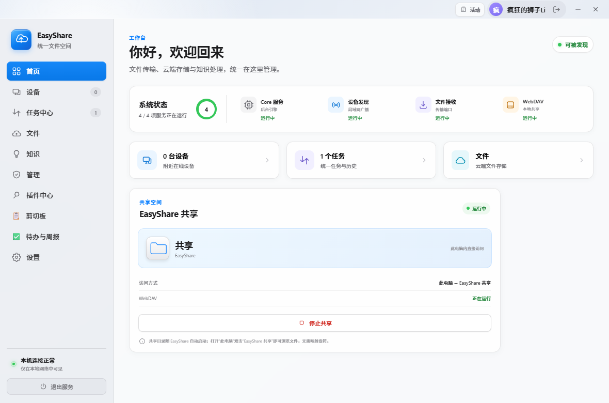
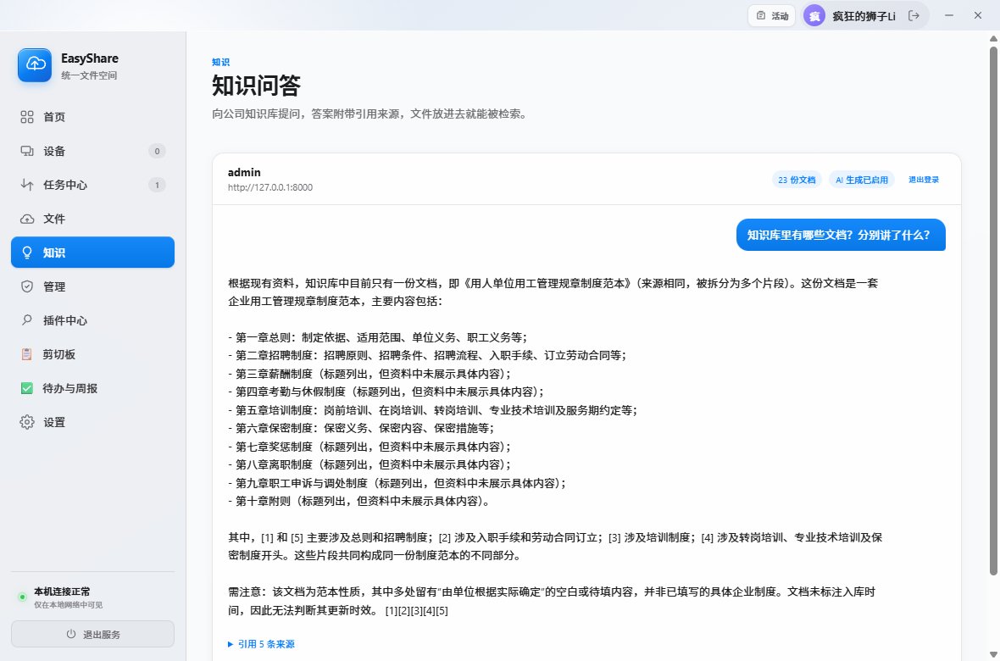
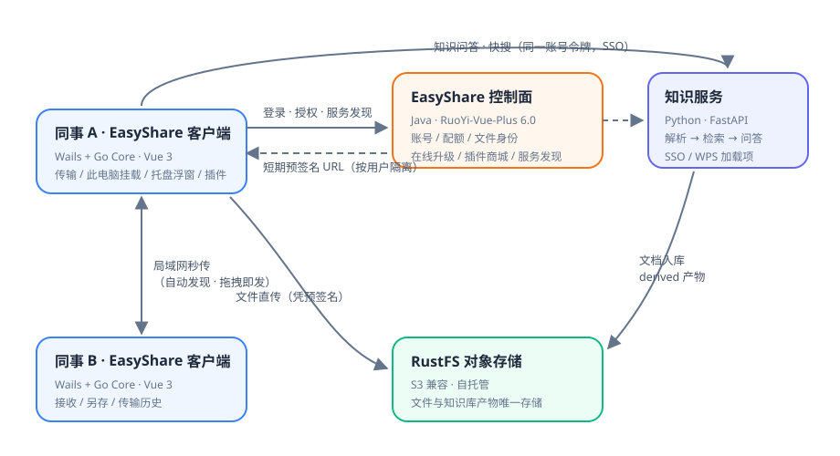
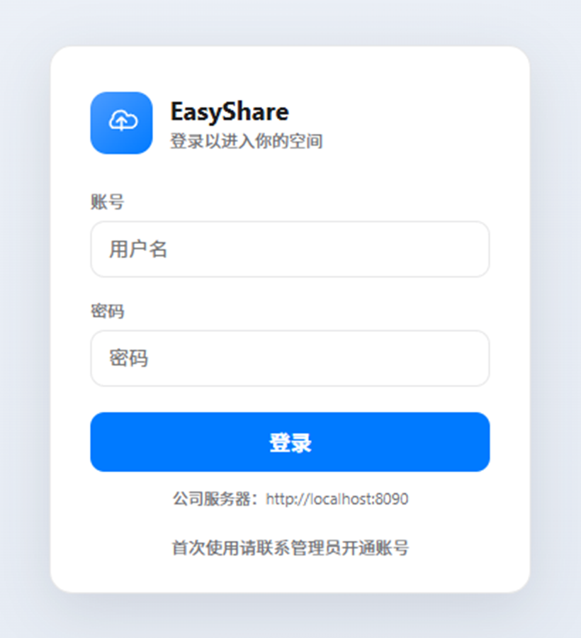

<div align="center">


**把「传文件、存文件、找文件」装进公司自己的服务器。**

Windows 10/11 · macOS · 全套私有化部署 · 数据不出内网

</div>

---

## ✨ 它有什么

不用公网、不用注册账号：一台公司里的服务器，每人电脑装一个客户端。

**文件，像本地一样快**

- 🔌 **局域网秒传** —— 同网段自动发现设备，拖拽即发，文件夹自动打包，接收方可另存或拒绝
- 🗂 **私有云盘挂进「此电脑」** —— 个人网盘与共享空间直接出现在 Windows 资源管理器（macOS 挂载到 Finder），复制粘贴就是上传下载
- 🔐 **数据不出内网** —— 文件存在自己的服务器上（RustFS 对象存储），客户端不持有任何存储凭据，每次上传下载都经控制面签发的短期预签名 URL 授权

**知识，问一句就有答案**

- 🧠 **文档自动变知识库** —— Word / PDF / Excel / PPT / 扫描件放进共享目录，约 1 分钟解析入库；目录监听持续同步，文件更新答案跟着新
- 💬 **三处都能问** —— 桌面客户端「知识」页、WPS 里选中段落一键查询、浏览器 `/lab`；答案附引用出处，点开即看原文
- 🛡 **权限跟着组织走** —— 部门级授权 + 文档级可见性：「这份制度只有研发能看」在问答链路端到端生效
- 📊 **质量看得见** —— 知识驾驶舱、管理员汇总页、观察期周报：使用率、盲区、回答质量都可度量

**IT，省心**

- ⚡ **15 分钟部署** —— 一台 Linux 服务器照着部署清单打勾即可，Windows 机器当服务器的简化版也有
- 🚀 **一分钟分发** —— 公司版安装包烧录服务器地址，同事装完即用；后续版本在线自动升级
- 🧩 **插件生态** —— 内置官方插件商城，剪贴板旗舰等插件按需安装

<div align="center">

<br><sub>工作台：系统状态、设备、任务与共享空间，统一在一个入口</sub>
</div>

<div align="center">

<br><sub>知识问答：向私有知识库提问，回答附引用来源，点开即看原文</sub>
</div>

## ⚙️ 它是怎么工作的



四个组件，各司其职：

| 组件 | 技术 | 职责 |
| --- | --- | --- |
| 桌面客户端 | Go（Core 后台进程）+ Vue 3 | 文件传输、系统集成（此电脑 / 托盘 / 悬浮窗）、插件宿主、知识网关 |
| 控制面 | Java（RuoYi-Vue-Plus 6.0） | 账号与登录、空间配额、文件身份、在线升级、插件商城、服务发现 |
| 对象存储 | RustFS（S3 兼容，自托管） | 文件与知识库产物的唯一存储，客户端凭短期预签名直传 |
| 知识服务 | Python（FastAPI） | 解析 → 清洗 → 切块 → 检索 → 生成全管线，WPS 加载项托管，MCP 接入 |

客户端只预知控制面一个地址，其余一切登录后自动下发；同一账号令牌通行桌面端与知识服务（SSO 单点登录）。

## 🚀 快速上手

**👨‍💼 同事（使用）**

拿到公司安装包 → 下一步装完 → 用分配的账号登录 → 完事。日常怎么用看[《同事上手指南》](docs/company-desktop-guide.md)（复制正文即可发群）。

<div align="center">

<br><sub>首启即见：品牌、账号入口与你公司的服务器地址——私有部署，开箱即用</sub>
</div>

**🛠 IT（部署）**

一台 2C4G 起步的内网 Linux 服务器：

```bash
git clone https://gitee.com/liilaifeng/easy-share.git /opt/easyshare/repo
bash /opt/easyshare/repo/deploy/server-linux/deploy.sh
```

再从开发机投递控制面、发公司版安装包——完整执行序见[**部署日 Checklist**](deploy/server-linux/DEPLOY-CHECKLIST.md)，每步都带验收点。WPS 插件安装、Windows 机器当服务器的简化部署见[公司部署指引](docs/company-rollout-guide.md)。

**💻 开发者（构建）**

```powershell
# 依赖：Go 1.25+ / Node.js / Wails CLI 2.14 / NSIS 3.x（打安装包时需要）
go install github.com/wailsapp/wails/v2/cmd/wails@v2.14.0
go mod download
npm ci --prefix frontend

# 桌面端开发模式
go build -o build/bin/easyshare-core.exe ./cmd/core
wails dev

# 全量流水线：Go 测试 + 前端测试 + 构建 + NSIS 安装包
powershell -ExecutionPolicy Bypass -File scripts/build.ps1
```

环境细节、服务端联调、macOS 构建、CI 与版本约定见[**开发手册**](docs/development.md)；代码结构与改动入口见[架构文档](docs/architecture.md)。

## 📚 文档导航

| 我想… | 去哪 |
| --- | --- |
| 了解架构、端口、API 事实 | [docs/architecture.md](docs/architecture.md) |
| 看进度、路线、迭代记录 | [docs/progress.md](docs/progress.md)（唯一真相源） |
| 部署到公司服务器 | [deploy/server-linux/DEPLOY-CHECKLIST.md](deploy/server-linux/DEPLOY-CHECKLIST.md) |
| 部署知识服务 / WPS 插件（Windows 服务器） | [docs/company-rollout-guide.md](docs/company-rollout-guide.md) |
| 搭开发环境、跑构建 | [docs/development.md](docs/development.md) |
| 理解知识平台的设计与边界 | [docs/knowledge-platform.md](docs/knowledge-platform.md) |
| macOS 支持与构建 | [docs/macos-port.md](docs/macos-port.md) |
| 排障 | [docs/troubleshooting.md](docs/troubleshooting.md) |

## 📌 当前状态

**v0.2.0**：桌面文件产品阶段 0–2 完成，云端 MVP（账号 / 云盘 / 在线升级）落地，知识平台检索管线加固完毕（混合检索 · 权限感知 · contextual chunking · SSO），正在推进公司真实环境部署观察。路线图与迭代记录见 [docs/progress.md](docs/progress.md)。
