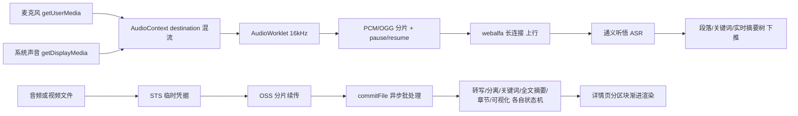

# 钉钉 AI 听记 逆向取证（二期）— 用 REA 拆到客户端产物本身

- 日期：2026-10-13
- 工具：REA 6.4.0（`rea-agents`，MCP + CLI，本机装于 `C:\Users\lishi\tools\rea`）
- 目标：拿到**可核对的原始证据**，弄清钉钉 AI 听记到底怎么工作，而不是靠截图猜
- 取证边界：只用公开可下载的前端产物 + 本机已安装客户端的配置文件 + 二进制字符串。**没有**破译登录态、**没有**抓用户流量、**没有**绕过任何鉴权
- 上一篇：[`2026-10-12-听记对标钉钉逆向.md`](../iterations/2026-10-12-听记对标钉钉逆向.md)（**其中"听记内部代号 memo"的结论是错的，见 §6 更正**）

---

## 1. 一句话结论

钉钉 AI 听记 = 内部代号 **闪记 / FlashMinutes**（前端工程 `we-flashing`，域名 `shanji.dingtalk.com`，服务端 RPC 前缀 `Minutes`），架构是**三条链路并存**：

1. **实时链路**：浏览器 AudioWorklet 采 16 kHz 音频 → PCM/OGG 分片流式上传 → 长连接 `wss://webalfa-*.dingtalk.com/long` 回推转写与**实时摘要树**；
2. **离线链路**：整文件（音频**或视频**）走 STS 临时凭据直传 OSS → `commitFile` → 服务端异步批处理；
3. **分任务异步 AI**：转写 / 说话人分离 / 关键词 / 全文摘要 / 章节 / 可视化报告 各是一个**独立任务、独立状态字段**，前端按区块渐进渲染。

ASR 引擎是阿里云**通义听悟（Tingwu）**，摘要求解走 **qwen-plus**。

---

## 2. 取证方法（可复现）

```bash
# 2.1 入口发现：桌面导航配置里 "AI 听记" tab 指向哪
grep -r -o -E ".{0,120}(听记|shanji|pctab_h5_memo).{0,120}" \
  "D:/Program/DingDing/main/current_new/configurations/navigator"

# 2.2 免登录取到应用外壳（注意 UA，非钉钉 UA 也返回 200）
curl -s -A "Mozilla/5.0 (Windows NT 10.0; Win64; x64) ... Chrome/120.0" \
  https://shanji.dingtalk.com/app/transcribes-list -o shanji.html

# 2.3 从外壳拿到生产 bundle 版本与地址，下载全量前端
#     //cdn.dingtalkapps.com/alidocs/we-flashing/2026.25.43/index.chunk.js  (5,490,343 B)
curl -s -o index.chunk.js https://cdn.dingtalkapps.com/alidocs/we-flashing/2026.25.43/index.chunk.js

# 2.4 REA 静态侧重建（产出带 evidence_id / sha256 的 JavaScriptApplicationGraph）
rea analyze-javascript-application "C:\path\to\shanji\app" --artifact-format directory --format json

# 2.5 原生壳字符串（听记不是 Electron，是 C++ 壳 + 云端 web）
grep -a -o -E "/r/Adaptor/[A-Za-z0-9_]+/[A-Za-z0-9_]+" MainFrame.dll | sort -u
```

REA 使用结论（诚实口径）：`analyze-javascript-application` 对 5.5 MB 单文件 webpack 产物给出 724 节点 / 833 边的模块图与产物哈希链（`evidence_id=ev_a7b7ed5c…`，`root_artifact_sha256=621b60eb…`），**结构取证有用、语义不够用**——webpack 模块 id 全是 `unresolved-reference`，真正的语义（RPC 名、字段、枚举、文案）来自字符串挖掘。本机无 Hopper/Ghidra/IDA，所以二进制侧只做了字符串级取证，未做反编译。

---

## 2b. 取证产物位置（其他 Agent 接手时先看这里）

原始产物**不入仓**（13 MB 二进制/压缩包，且是可再下载的公开资源），已落盘在：

```
C:\Users\lishi\tools\reverse-artifacts\dingtalk-shanji\
  index.chunk.js            5,490,343 B  we-flashing/2026.25.43 生产 bundle（本文所有客户端结论的来源）
  index.chunk.css / shanji.html            外壳与样式（og:title=AI 听记，无 Cookie 即 200）
  app/                                     喂给 REA 的目录（analyze-javascript-application 的输入）
  rea-js-analysis.json        2.2 MB       REA 产出的 JavaScriptApplicationGraph（含 evidence_id / sha256）
  i18n_report.txt / enums_report.txt / audio_params.txt   挖掘结果快照
```

复现下载（换版本号即可取新版；`index.chunk.js.map` 服务端 404，官方不发源码图）：

```bash
curl -s -A "Mozilla/5.0 (Windows NT 10.0; Win64; x64) Chrome/120.0" \
  https://shanji.dingtalk.com/app/transcribes-list -o shanji.html
grep -o 'alidocs/we-flashing/[0-9.]*/index.chunk.js' shanji.html   # 取当前版本号
curl -s -o index.chunk.js "https://cdn.dingtalkapps.com/alidocs/we-flashing/<版本号>/index.chunk.js"
```

挖掘脚本已入仓可复用：`scripts/reverse/minutes-i18n-mine.py`（i18n/命名空间统计）与
`scripts/reverse/minutes-enum-mine.py`（枚举与取值）。REA 本机安装位置与调用方式见
[`../iterations/2026-10-13-听记对标二期一.md`](../iterations/2026-10-13-听记对标二期一.md) 头部说明
（CLI：`rea`，PATH 入口 `~\.local\bin\rea.cmd`；MCP 已注册进 Qoder user scope）。

---

## 3. 证据清单

| # | 证据原文（可在产物中检索） | 出处 | 结论 |
| --- | --- | --- | --- |
| E1 | `default_navigator_v5.json` 两个相邻 tab：`appId:"flashminutes"` + `mcmsKey:"pctab_flashminutes"` + `zh_CN:"AI听记"` + `i18nDesc:"会议内容，轻松记录"` → `openUrl:" https://shanji.dingtalk.com/"`；`appId:"h5_memo"` + `zh_CN:"便签"` + `"简洁记录，随手笔记"` → `openUrl:"https://pre-memo.dingtalk.com/desktop_x.html#/desktop"`（海外版 `default_navigator_overseas.json` 里 `zh_CN:"AI 听记"` 配 `openUrl:"https://shanji.dingtalk.com/app/transcribes-list?from=pc_tab"`） | `configurations/navigator/` | 桌面「AI 听记」= **appId `flashminutes`**，打开 **`shanji.dingtalk.com`**；`h5_memo` 是**便签**，与听记无关 |
| E2 | `og:title=AI 听记`、`description=简单易用、安全可靠的会议语音转文字工具` | `shanji.dingtalk.com/app/transcribes-list`（HTTP 200，5,661 B，无 Cookie） | 听记外壳与 bundle **公开可取**，不需要登录即可静态分析 |
| E3 | 路由 `/app/transcribes-list`、`/app/transcribes/{id}`、`/app/convert?dentryId=`、`/app/transcribes-hardware` | 外壳 + `MainFrame.dll` 字符串 | 列表 / 详情 / **由云盘文件(dentryId)发起转写** / 硬件录音 四个入口。`dentryId` 说明"网盘文件→听记"是产品级路径 |
| E4 | `pid:"we-flashing", version:"2026.25.43"` | 外壳埋点初始化 | 前端工程名 `we-flashing`，版本化发布于 `cdn.dingtalkapps.com/alidocs/` |
| E5 | `/r/Adaptor/FlashMinutesI/createFlashMinutesV2`、`endMinutes`、`generateToken`；`/r/Adaptor/FlashMinutesAppV2I/commitFile`、`endMinutes` | bundle + `MainFrame.dll` | 生命周期三段：**建任务 → 提交文件/推流 → 结束**。`commitFile` 证实离线链路以"文件"为单位 |
| E6 | `tingwu` / `Tingwu` / `common.tingwu`、`tongyi`、`qwen-plus` | bundle 字符串 | ASR = **通义听悟**，LLM = **qwen-plus**（非自研 ASR） |
| E7 | `wss://webalfa-cm3.dingtalk.com/long`、`webalfa-sandbox…/long`、`recordWebSocketEvent` | bundle | 实时结果通过钉钉 **webalfa 长连接**下推，不是自开 WS |
| E8 | `recorder:{format: OGG\|PCM, sampleRate:16e3, bufferSize: lower?1024:2048}`、`createMediaStreamSource` → `audioWorklet`(有则用)否则 `ScriptProcessor`、`handleChunk` 且返回 `{stop, resume, pause}` | bundle @ 录音 SDK 段 | **16 kHz**，可**暂停/恢复**，AudioWorklet 优先——与我们 `recorder.ts` 同构，但多了暂停与 OGG 压缩上行 |
| E9 | `new AudioContext()` + `createMediaStreamDestination()`，把 `t.getAudioTracks()[0]`（麦克风）与 `n.getAudioTracks()[0]`（`getDisplayMedia` 系统声音）**同时 connect 到同一个 destination**，再取 `destination.stream` | bundle @ 屏幕音频段 | 系统声音 + 麦克风的官方做法：**AudioContext 混流**，不是分别录两路再拼 |
| E10 | `client.error.inValidAudioChunk`、`fm_client_id` | bundle | 上行按 **chunk** 校验，客户端会话有独立 id |
| E11 | 扩展名白名单 `mp3 wav aac ogg oga flac m4a opus amr wma mid midi aiff au` + 视频 `mp4 m4v mov webm ogv mkv avi wmv flv mpeg mpg ts m2ts 3gp`；服务 `/r/Adaptor/MinutesScreenI/createScreenMinutes/getUploadAddress/screenUploadFinish` | bundle | **导入支持视频**（对视频做语音转写）；另有**屏幕录制听记**专用上传链路 |
| E12 | `getSecurityToken` / `stsToken` / `accessKeyId` / `uploadAddress` / `checkpoint` / `bucketName` + 外壳加载 `ali-oss-6.13.0-sdk.min.js` | bundle + 外壳 | 大文件走 **STS 临时凭据 + OSS 分片续传（checkpoint）**，客户端不持长期密钥 |
| E13 | 区块状态字段：`KeywordsStatus`、`FullTextSummaryStatus` + `FullTextSummarySubStatus`、`SeparateStatus`、`ChapterCoverState`、`AudioSegmentsStatus`、`SpeakerRecommendStatus`、`ExtractStatus`、`FileImportStatus`、`VisualizationSummaryTaskStatus`、`TaskServerStatus`；已见取值 `.initial` `.processing` `.generating` | bundle @3474573 / @3478699 / @3480433 / @3523812 | **没有全局"完成"状态**。每个 AI 产物各自一个状态机，前端分区块渐进渲染/重试 |
| E14 | `/r/Adaptor/PortalMinutesI/`：`queryKeywords`、`queryMeetingBrief`、`queryAudioSegments`、`queryChapterCover`、`minutesSpeakerList`、`createSeparateTask`、`separateStatus`、`mergeParagraph`/`splitParagraph`/`searchParagraph`、`paragraphContentUpdate`/`paragraphNickNameUpdate`/`paragraphMarkUpdate`、`editKeyPoint`/`editChapter`/`editFullTextSummary`、`getRealTimeTaskInfo`、`heartBeat`/`editHeartBeat`、`getEditLock`/`releaseLock`、`collectMinutes`/`queryCollectedMinutes`、`updateMinutesTitle`/`updateMetaData`、`minutesDetailV2`、`fetchMinutesDataList`/`fetchMinutesListByTag`、`getHomeTabList`/`updateHomeTabList` | bundle | 详情页 API 全景。**`queryAudioSegments` = 智能切片的后端**；`getEditLock/releaseLock` = 协同编辑锁；`getHomeTabList` = 首页 tab 可配置 |
| E15 | `/r/Adaptor/MinutesTodoI/`：`createDingtalkTodo`、`updateDingtalkTodo`、`updateDingtalkTodoStatus`、`deleteDingtalkTodo`、`queryDingtalkTodoList`、`getConfMinutesAttendee` | bundle | 待办是**一等实体**（可增删改查 + 状态流转 + 执行人），落到钉钉待办 |
| E16 | `todo.*` i18n：`设置待办内容后，待办会自动同步到对方的日历`、`addExecutor/whoExecute`、`dueDate/setDueDate`、`reminderMethod`→`tel/sms/inApp`、`beforeDueDate/onDueDate/today/tomorrow` | bundle i18n | 待办带**执行人、截止时间、提醒方式（电话/短信/应用内）**，并同步日历 |
| E17 | `/r/Adaptor/MoziVoicePrintAppI/`：`authorizeVoicePrint`、`toggleVoicePrint`、`clearVoicePrint`、`getVoicePrintConfig`、`getLabelList`、`deleteLabel`、`checkDuplicateLabel`、`updateLabeledPerson`；`voicePrint.*` i18n：`AI将通过声纹识别你的发言并在会议和 AI 听记中展示`、`声纹已标注，后续自动识别`、`已在{number}篇听记中识别`、`智能推测出{num}位发言人`、`合并发言人`、`《声纹识别服务个人信息处理规则》` | bundle | **声纹注册是一等功能**：授权 → 采集 → 标注发言人 → 跨会议持久识别 → 合并/清除，且配了**个人信息处理合规文案** |
| E18 | `hotwords.*` i18n：`添加常用词汇（如人名、地名、专业名词等），AI将优先识别这些词，提高转写准确率`；约束 `中文/日语词：10个字符`、`英文词：5个单词`、`混合词：10个字符`、`已添加热词 {count}/{max}个` | bundle | **个性化热词库**（对应听悟 phrase 能力），有明确长度/条数校验规则 |
| E19 | `/r/Adaptor/FlashMinutesSummaryAppI/`：`querySummaryModels`、`queryTemplateBrief`、`queryTemplateDetails`、`generateMinutesSummary`、`changeSummaryTask`；`/r/Adaptor/MinutesSummaryDiyTemplateAppI/`：`queryDiyTemplate`、`queryDiyTemplateByKey`、`queryUserAvailableDiyTemplates`；i18n `flashMinutes.templateName.placeholder=请输入模板名称（最多150字）`、`summary.currentTemplate=当前模板`、命名空间 `customTemplateForm`(12)、`useGenerateAiPrompt`、`useAIStreamingNetworkForCustomTemplate` | bundle | 模板体系：**官方模板 + 用户 DIY 模板 + 用 AI 流式生成模板提示词**，且可**切换模型**（`querySummaryModels`）后重跑（`changeSummaryTask`） |
| E20 | 命名空间 `retranscribeMainView`(8)、`useRetranscribePage`、`retranscribeModal`、`useRetranscribeSubmit` | bundle | **重新转写**是独立页面级功能（换模板/换模型重跑同一份音频） |
| E21 | `realtimeSummary`、`realtimeSummaryTreeNode.editableTextPlaceholder=请输入文本`、`realTimeSummary.trail.tip=免费版仅展示首次总结，升级后持续更新本场要点`、`completedSummaryTreePage`(9)/`completedSummaryTreeTab` | bundle | 录音中有**实时摘要树**（可编辑），会后转成"已完成摘要树"；免费版只给首次总结 → **商业化卡点** |
| E22 | `visualization`(22)、`insightReport`、`visualSummary`、`/dingding/minutes-visualization/report-style/index.html`、`/dingding/flash-minutes/SummaryTemplateConfig.html`、`ExportToWeWordStatus`、`getDingDocAccessToken` | bundle | **可视化报告**是独立前端产物（报告样式包）；导出落到**钉钉文档/语雀 WeWord** |
| E23 | `mcp`(20) i18n：`使用外部AI工具读取{brand}`、`帮你查纪要、写周报、追待办`、`modal.title=安装钉钉CLI`、`mobile.cliInstallCommand=钉钉CLI安装指令`、`需选择组织，可读取组织内已授权数据、全部个人数据` / `无需选组织，仅读取个人数据`、`不支持DeepSeek、元宝等纯AI对话交互类应用` | bundle | 听记 MCP 的**交付形态是"复制一条 CLI 安装指令"到外部 Agent**，并区分**个人域 / 组织授权域**两种数据范围 |
| E24 | `MinutesEamI` 15 个方法：`permissionPanel`、`addPermission`、`saveShareScope`/`getShareScopeV2`、`shareToConversationV2`、`inviteAndShareToConversationV2`、`listMembers`、`queryMemberStatistics`、`postApply`、`preCheck` | bundle | 听记条目有**企业级权限模型（EAM）**：共享范围、成员、统计、申请审批 |
| E25 | `knowledgeSyncFields`(6)/`knowledgeBaseSelector`/`knowledgeSync`、`tagManageModal`(10)/`createTagModal`(12)/`getRecommendTagList`、`batchDownload`(7)/`batchDelete`、`incognito`(14)/`incognitoMode`、`quota`(3)/`capacity`/`usageRecord`(14)/`benefits`(16)/`bookMinutes` | bundle | 其余产品面：**同步知识库、标签管理、批量下载、无痕模式、配额与用量明细** |
| E26 | `%APPDATA%\DingTalk\mcp_port` = `{"http_port": 8440, "pid": 40736}`；`POST 127.0.0.1:8440/mcp` → `{"error":{"code":-32600,"message":"access denied: missing Authorization header"}}`；`Get-NetTCPConnection` 显示该端口由 DingTalk.exe 监听 | 本机实测 | 客户端里确实常驻一个**本地 MCP 服务**，只差配对令牌（令牌仅在 UI 生成，本地不落盘）——本轮唯一未取到的证据 |

---

## 4. 架构拆解（对应我们要抄什么）



三条设计选择值得直接搬：

1. **区块级状态机**取代全局 `processing→completed`：某一块失败只重试那块，用户先看到转写再看到摘要。
2. **混流而不是双轨**：系统声音与麦克风在 AudioContext 里合成一路，后端只见一路音。
3. **实时用分片流、离线用整文件**：两条链路共用同一套后端 AI 任务，前端按能力选入口。

---

## 5. i18n 命名空间 = 产品功能清单（体量参考）

`common` 355 / `permission` 139 / `detail` 113 / `upload` 41 / `client` 41 / `todo` 35 / `recorder` 30 / `feedback` 29 / **`voicePrint` 26** / `summary` 23 / **`visualization` 22** / **`hotwords` 21** / **`mcp` 20** / `editor` 20 / `mobile` 19 / `list` 18 / `transfer` 16 / `benefits` 16 / `usageRecord` 14 / `incognito` 14 / `filter` 14 / `customTemplateForm` 12 / `createTagModal` 12 / `mindMap` 5 / `fullTextSummary` 6 / `quota` 3

（统计自 `index.chunk.js` 内嵌多语言表，脚本 `scripts/reverse/minutes-i18n-mine.py`，共 1,594 条 key。）

---

## 6. 对上一篇文档的更正

- 上一篇记「听记 tab = `AI听记`（i18n key `pctab_h5_memo`），入口 `https://memo.dingtalk.com/desktop_x.html#/desktop`，内部代号 **memo**」。**错在把导航里两个相邻 tab 合并成了一个**（见 E1）：
  - `h5_memo` / `pctab_h5_memo` 的 `zh_CN` 实际是**「便签」**（描述"简洁记录，随手笔记"），`memo.dingtalk.com` 未登录 302 到 `login.dingtalk.com`，登录页标题正是**「钉钉便签」**；
  - 听记是另一个 tab：`appId:"flashminutes"` / `mcmsKey:"pctab_flashminutes"` / `zh_CN:"AI听记"`，`openUrl` 指向 **`shanji.dingtalk.com`**。
  - 听记真实代号 = **闪记 / FlashMinutes / we-flashing**（服务端 RPC 前缀 `Minutes`）。
- 由是这个更正带来的直接后果：上一篇把"静态侧无资源可拆"记成死路，实际**闪记外壳与 bundle 免登录可取**（E2/E3），整个客户端逻辑都能静态分析。

---

## 7. 与 EasyShare 现状差距（对照 `internal/meetingsmcp`、`knowledge/app/meetings`、`frontend/src/services/recorder.ts`）

| 能力 | 钉钉证据 | 我们现状 | 差距 |
| --- | --- | --- | --- |
| 关键词 | E14 `queryKeywords`、E13 `keywordStatus` | 无字段 | **缺** |
| 实时上屏 | E7/E8/E10/E21 分片流 + 实时摘要树 | 明确"不做"，纯批处理 | **缺**（最大落差） |
| 说话人 | E17 声纹注册 + `startRealtimeSeparateSpeaker` | cam++ 聚类 + 手工改名，无声纹 | **缺** |
| 智能切片 | E14 `queryAudioSegments` | 只有章节锚点 | **部分** |
| 模板体系 | E19 DIY 模板 + AI 生成提示词 + 换模型重跑 | 7 个内置模板，前端硬编码 | **缺** |
| 重新转写 | E20 独立页面 | 只有"重生成摘要" | **部分** |
| 待办 | E15/E16 一等实体 + 执行人/截止/提醒 | `MeetingTodo` 只读展示 | **缺** |
| 导入视频 | E11 视频白名单 | 仅音频解码 | **缺** |
| 上传 | E12 STS + 分片续传 | 一次性 multipart | **缺**（大文件不稳） |
| MCP 只读面 | E23 个人/组织双域 + CLI 指令分发 | 4 个只读工具，单域 | **部分**（缺关键词/音频/待办工具） |
| 导出 | E22 钉钉文档/WeWord | DOCX + 海报 PNG | 够用 |

---

## 8. 仍未取到的证据（下一轮）

`127.0.0.1:8440/mcp` 的 `tools/list` 与真实响应样本——需要钉钉客户端「立即连接」生成的配对令牌（仅 UI 出，不落盘）。拿到后能直接验证：听记 MCP 的真实工具名、入参、返回字段命名，以及"个人域 / 组织授权域"的差别。
